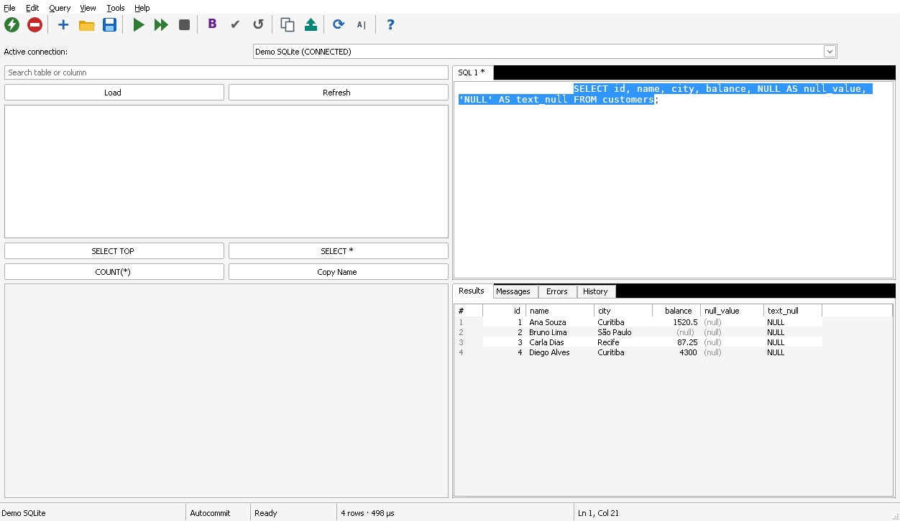

# GoQueryOne

A small, portable Windows SQL client for any ODBC data source: one `.exe`,
no installer, no runtime. It is meant as a modern replacement for the classic
*ODBC Query Tool*: pick a DSN (or a driver / connection string), type SQL, press
F5.



## Features

- Connect through a DSN, a file DSN, a driver name or a raw ODBC connection
  string. Saved connection profiles; passwords are optional and stored only
  encrypted with Windows DPAPI.
- SQL editor tabs with open/save, unsaved-changes prompt and a monospace font.
- **F5** runs the statement under the caret (and highlights it), **F6** runs
  the whole script, **Esc** cancels. Every statement is executed exactly once.
- Results grid with row numbers, `(null)` shown distinctly from the text
  `'NULL'`, right-aligned numbers, auto column widths and multi-row copy that
  pastes straight into Excel. **F9** toggles an aligned text view.
- Messages, Errors and History tabs; rows affected and human-friendly
  durations in the status bar.
- Export to CSV, TSV, JSON, Markdown or plain text.
- Manual transactions (Begin / Commit / Rollback), load more rows and ODBC
  Administrator shortcuts for x64 and x86.
- Schema browser tree (tables, views, columns, keys and indexes) read through
  the ODBC catalog API; double-click for a `SELECT TOP` (or `LIMIT` / `FETCH
  FIRST`, matching the database) or to insert a column name.
- DSN and driver pickers that list what is installed for the exe's bitness,
  connection-string templates, New / Duplicate / Delete profiles and
  one-step **Tools > Connect to**.
- Settings dialog (timeout, row limits, editor font size, system tables,
  opt-in query history with passwords masked). Window, splitters and open SQL
  files are restored at the next start.

## System requirements

- Windows 10 or 11 (x64 or x86). Go no longer supports Windows 7/8.
- An ODBC driver for your database. **The exe and the driver must have the
  same bitness**: use `GoQueryOne-x64.exe` with 64-bit drivers and DSNs, and
  `GoQueryOne-x86.exe` with 32-bit ones (for example the old Jet/Access
  drivers). A mismatch shows up as error `IM014` or "data source name not
  found".

## Getting started

1. Download the zip for your architecture and extract it anywhere (a USB stick
   works).
2. Start `GoQueryOne-x64.exe` (or `-x86`).
3. **Tools → Connect…** (Ctrl+Shift+C), choose a DSN or enter a connection
   string, press **Connect**.
4. Type SQL and press **F5**.

The user guide covers everything else: [docs/USER_GUIDE.md](docs/USER_GUIDE.md).

### Where settings are stored

| Situation | Config file |
|---|---|
| `GOQUERYONE_CONFIG` is set | that path |
| `portable.flag` next to the exe, or the exe folder is writable | `config.json` next to the exe (portable mode) |
| otherwise | `%APPDATA%\GoQueryOne\config.json` |

Encrypted credentials go to `credentials.json` in the same folder and can only
be decrypted by the same Windows user.

## Building from source

Everything cross-compiles from Linux or Windows with Go 1.24+ and no C
compiler:

```bash
make check      # gofmt, go vet (host + windows/amd64 + windows/386), unit tests, both builds
make build      # dist/GoQueryOne-x64.exe and dist/GoQueryOne-x86.exe
make release VERSION=1.0.0   # local zips + SHA256SUMS.txt in dist/ (nothing is published)
```

Without `make`, run `scripts/check.sh` directly, or:

```bash
GOOS=windows GOARCH=amd64 CGO_ENABLED=0 go build -trimpath -ldflags "-s -w -H=windowsgui" -o dist/GoQueryOne-x64.exe ./cmd
```

See [docs/DEVELOPER.md](docs/DEVELOPER.md) for the architecture, tests and the
Wine smoke test. The Dockerfile is optional.

## License

[MIT](LICENSE).
